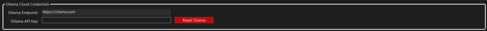
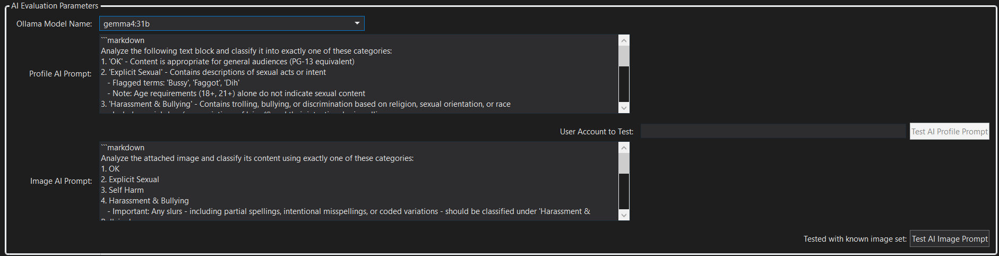
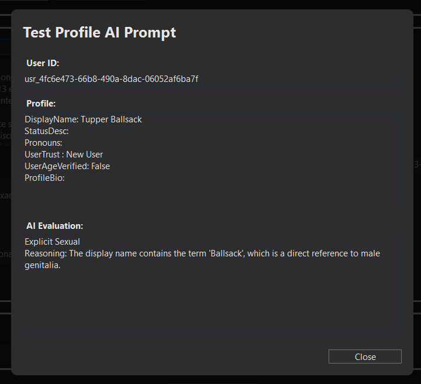
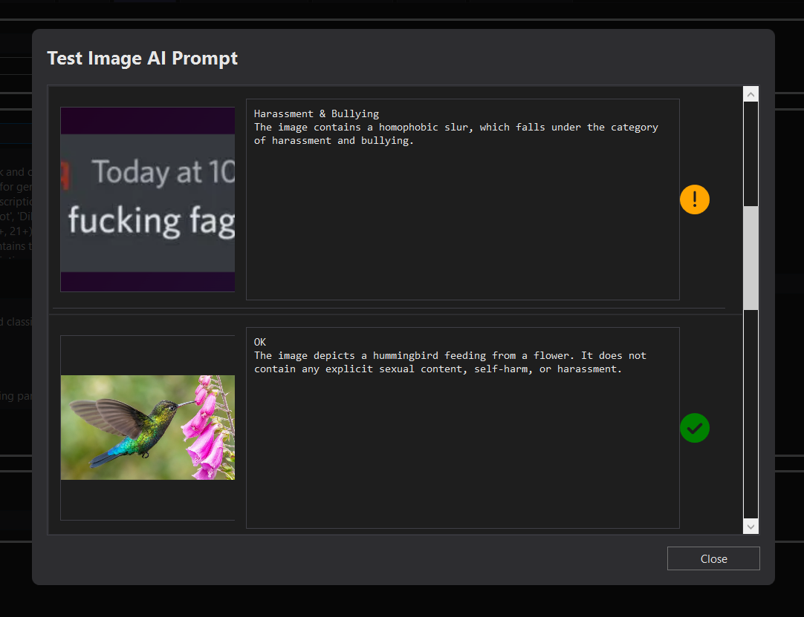

# Tailgrab Setup -- AI Configuration Guide

**IT IS NOT NESSASARY TO SET UP AI CONFIGURATION TO USE TAILGRAB, BUT IT IS RECOMMENDED FOR INSTANCES THAT WANT TO AUTOMATE THE CLASSIFICATION OF USER GENERATED CONTENT.**

Tailgrab _**can be configured**_ to use a Local or Cloud Ollama AI model for classifications of user Profiles and User Generated Image content in your instance. The AI model will return a classification result that Tailgrab can use to determine if the user is a potential threat or not in your instance.  This helps in filling out the 'In Game Reports' of harmful cotent and reduces the amount of content that needs to be manually reviewed by VR Chat moderation team.

This guide will walk you through the steps to configure Tailgrab with an Ollama AI model.

---

## Table of Contents
1. [Overview](#overview)
2. [Option 1: Local Ollama AI (Not recommended)](#option-1-local-ollama-ai-not-recommended)
   - [Installation on Windows 11](#installation-on-windows-11)
   - [Performance Considerations](#performance-considerations)
   - [Recommended Models](#recommended-models)
   - [Configure Tailgrab with Your Local Settings](#configure-tailgrab-with-your-local-settings)
3. [Option 2: Ollama Cloud AI (Fast, Free & Recommended)](#option-2-ollama-cloud-ai-fast-free--recommended)
   - [Ollama Cloud Setup](#ollama-cloud-setup)
     - [Step 1: Create a Free Ollama Cloud Account](#step-1-create-a-free-ollama-cloud-account)
     - [Step 2: Generate an API Token](#step-2-generate-an-api-token)
     - [Step 3: Configure Tailgrab with Your API Token](#step-3-configure-tailgrab-with-your-api-token)
4. [AI Evaluation Parameters](#ai-evaluation-parameters)
   - [Classification Theory](#classification-theory)
   - [Profile Evaluation](#profile-evaluation)
   - [Image Evaluation](#image-evaluation)

---

## Overview

When a user joins your instance and has not been seen yet or has changed their bio, status, pronouns or spawns out user supplied image content from a Sticker, Emoji or Print; Tailgrab can send that content to a configured Ollama AI model for classification. The AI model will return a classification result that Tailgrab can use to determine if the user is a potential threat or not in your instance.
AI is not required to review this content, but it can be used to help reduce the amount of content that needs to be manually reviewed by your moderation team and support quick reaction time to abusive content in the instance.

Reference image:

<a href="OllamaCloudCredentials.png" text="Tailgrab AI Credentials"></a>

---

## Option 1: Local Ollama AI (Not recommended)

### Installation on Windows 11

To use a local Ollama AI model, you must first install Ollama on your Windows 11 system.

1. Download Ollama from [ollama.ai](https://ollama.ai)
2. Run the installer and follow the installation prompts
3. After installation, open a PowerShell or Command Prompt and verify the installation by running:
   ```powershell
   ollama --version
   ```
4. Pull a recommended model by running:
   ```powershell
   ollama pull gemma4:13b
   ```
5. Start the Ollama server:
   ```powershell
   ollama serve
   ```

### Performance Considerations

**CPU-Only Performance (No GPU):**
- Running Ollama without GPU acceleration is **unbearably slow** and is not recommended for production use
- Response times can take several minutes for AI classifications
- This approach is only suitable for testing in non-time-critical scenarios

**GPU Performance:**
- Even with dedicated GPU acceleration, performance may still be **slow** compared to cloud-based alternatives
- **Do NOT run Ollama and VRChat on the same GPU** - this will severely degrade performance for both applications
- Both applications are GPU-intensive and competing for resources will result in unacceptable latency

### Recommended Models

For optimal performance with local deployment:
- **Minimum:** `Gemma4:13B` - requires 8-10GB VRAM
- **Preferred:** `Gemma4:31B` - requires 20GB+ VRAM (if your hardware can support it)

These models provide the best balance between response quality and inference speed for content classification tasks.

#### Configure Tailgrab with Your Local Settings

1. In Tailgrab settings, navigate to the AI Configuration section
2. Enter your Ollama local endpoint URL if using a custom domain (Typically 'http://localhost:11454')
3. Put anything into the API Token (Single word or random string, as it is not used for local deployments, but is used as a flag to run AI sub code.)
4. Save your configuration

Your Tailgrab instance is now ready to use Ollama Local for AI-powered content classification.

---

## Option 2: Ollama Cloud AI (Fast, Free & Recommended)

### Ollama Cloud Setup

Ollama Cloud provides fast, free AI classification without the overhead of local hardware. Follow these steps to set up your free account and generate an API token.

#### Step 1: Create a Free Ollama Cloud Account

Per User, they can sip from the free fountain w/o any cost, unless you have money to burn to issue a 'Team Account' for your group.  The free account is more than enough for most instances, and you can always upgrade later if needed.

1. Visit [ollama.cloud](https://ollama.cloud) (or [console.ollama.cloud](https://console.ollama.cloud))
2. Click **Sign Up** or **Create Account**
3. Enter your email address and create a secure password
4. Verify your email address via the confirmation link sent to your inbox
5. Complete any additional account setup steps (name, organization, etc.)

#### Step 2: Generate an API Token

1. Log in to your Ollama Cloud account
2. Navigate to **API Keys** or **Settings** → **API Keys** (location varies by UI version)
3. Click **Create New API Key** or **Generate Token**
4. Give your token a descriptive name (e.g., "Tailgrab Production")
5. Select the appropriate permissions scope if prompted
6. Click **Generate** or **Create**
7. **Copy the token immediately** - it will only be displayed once for security reasons
8. Store the token securely (password manager, environment variable, etc.)

#### Step 3: Configure Tailgrab with Your API Token

1. In Tailgrab settings, navigate to the AI Configuration section
2. Select **Ollama Cloud** as your AI provider 
3. Paste your API token in the **API Token** field
4. (Optional) Enter your Ollama Cloud endpoint URL if using a custom domain (Typically 'https://ollama.com')
5. Save your configuration

Your Tailgrab instance is now ready to use Ollama Cloud for AI-powered content classification with no local hardware requirements.


---

## AI Evaluation Parameters

When configuring Tailgrab to use an Ollama AI model, you can specify the following parameters:

Reference image:

<a href="AIEvaluationParameters.png" text="Tailgrab AI Evaluation Parameters"></a>


---

### Classification Theory

We need to classify content into 4 major categories that are hard coded into the application, the AI Prompt is sent with the content and instucts the AI to evaluate the content and output the results into a predetermined format that Tailgrab can use.  When modifying the prompts, it is wise to think of the AI as an 'Autistic 5 year old with a Encyclopedia'; you need to be specific in most cases with guardrails otherwise they get lost.

The results should be output in the following format, excluding brackets:
```markdown
[Classification]
[Reasoning]
```

where a typical response might look like:
```markdown
Explicit Sexual
The content contains descriptions of sexual acts with your promiscous mother...
```

---

### Profile Evaluation

While evaluating a user profile, the AI will be sent the following prompt with the content of the profile and will return a classification result that Tailgrab can use to determine if the user is a potential threat or not in your instance.

The preconfigured prompt is as follows:
```markdown
Analyze the following text block and classify it into exactly one of these categories:
1. 'OK' - Content is appropriate for general audiences (PG-13 equivalent)
2. 'Explicit Sexual' - Contains descriptions of sexual acts or intent
   - Flagged terms: 'Bussy', 'Faggot', 'Dih'
   - Note: Age requirements (18+, 21+) alone do not indicate sexual content
3. 'Harassment & Bullying' - Contains trolling, bullying, or discrimination based on religion, sexual orientation, or race
   - Includes racial slurs (e.g., variations of 'nigg*') and their intentional misspellings
4. 'Self Harm' - Describes explicit self-destructive behaviors

Classification Guidelines:
- Use 'OK' if content is ambiguous or lacks sufficient information
- Translate any non-English text to English before classification
- Consider context when evaluating flagged terms

Output the results in the following format, excluding brackets:
[Classification]
[Reasoning]
```

If you edit this prompt, there is a field that lets you test it against an existing User Profile and get the results back before saving your changes.

Reference image:

<a href="ProfilePromptTestResults.png" text="Tailgrab AI Profile Prompt Test Results"></a>


---

### Image Evaluation

While evaluating Prints, Stickers and Emojis that the user has uploaded or access to, this prompt plus the image (Or the SpriteSheet of an Animated Emoji) are sent to the AI Model

The preconfigured prompt is as follows:
```markdown
Analyze the attached image and classify its content using exactly one of these categories:
1. OK
2. Explicit Sexual
3. Self Harm
4. Harassment & Bullying
   - Important: Any slurs - including partial spellings, intentional misspellings, or coded variations - should be classified under 'Harassment & Bullying'.

Classification Guidelines:
- Use 'OK' if content is ambiguous or lacks sufficient information
- Translate any non-English text to English before classification

- Consider context when evaluating flagged terms

Output the results in the following format, excluding brackets:
[Classification]
[Reasoning]
```

There is a button that lets you test the prompt against an existing image set and get the results back before saving your changes.

Reference image:

<a href="ImagePromptTestResults.png" text="Tailgrab AI Image Prompt Test Results"></a>

