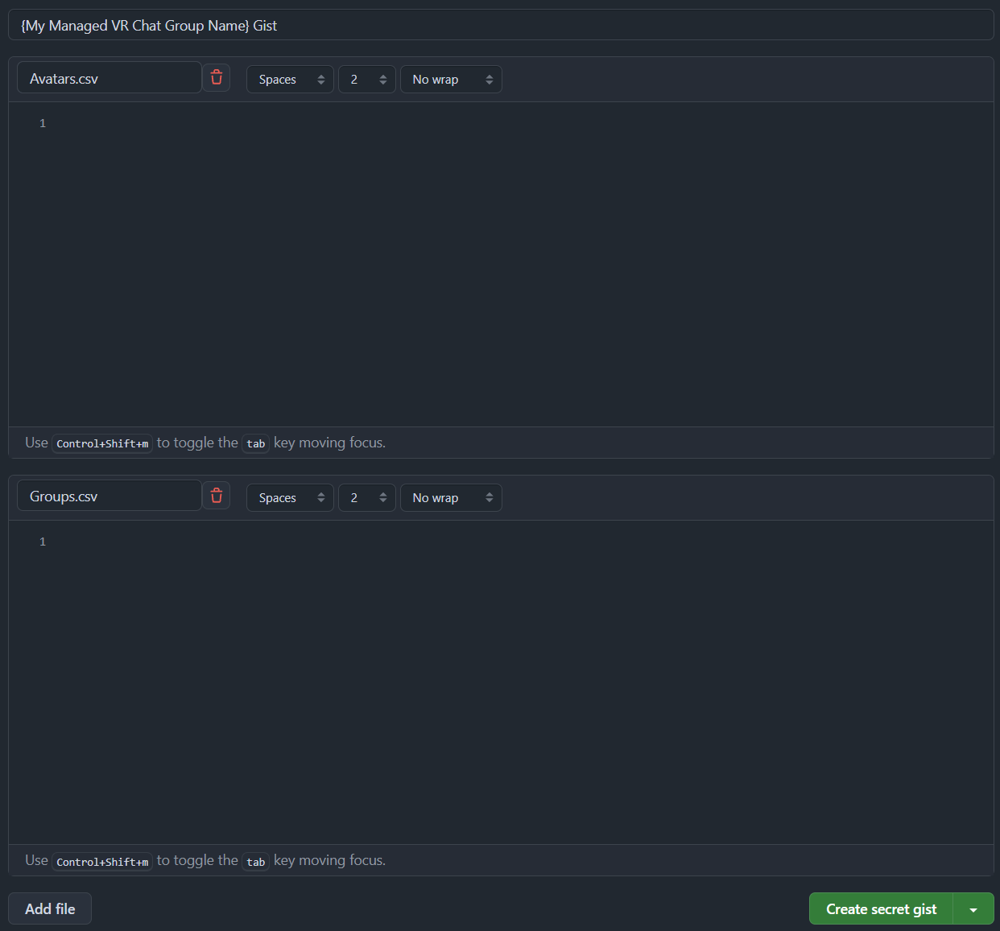

# Tailgrab Setup -- Gist Group and Avatar Watch Management

This guide explains how to configure Tailgrab to manage your Gist groups and avatar watch settings. Tailgrab provides two configuration methods: **Shared GitHub Gist** (recommended for teams) and **Manual URLs** (for self-hosted or alternative storage).

---

## Table of Contents
1. [Overview](#overview)
2. [Option 1: GitHub Gist Setup (Recommended)](#option-1-github-gist-setup-recommended)
3. [Option 2: Manual URLs (Self-Hosted)](#option-2-manual-urls-self-hosted)
4. [Security & Personal Access Tokens](#security--personal-access-tokens)
5. [Configuration in Tailgrab](#configuration-in-tailgrab)
6. [Reconfiguration After Initial Setup](#reconfiguration-after-initial-setup)
7. [Troubleshooting](#troubleshooting)

---

## Overview

Tailgrab can share or accept shared configuration lists for your team's Avatar and Group watched records:
- **Avatar Gist**: Defines avatar watch levels
- **Group Gist**: Defines group watch levels

You can host these files on GitHub Gists (easiest for teams and the administrator) or hosted on your own webserver (more control, more work).

---

## Option 1: GitHub Gist Setup (Recommended)

### Prerequisites
- A GitHub account (_**free**_ or paid)
- [GitHub Gists](https://gist.github.com) access

### Step 1: Create a Shared GitHub Gist

1. Go to [https://gist.github.com](https://gist.github.com)
2. Create a new Gist (click **+ New Gist** in top-left)
3. For each file you need:
   - **Avatar file**: Name it `Avatars.csv`
   - **Group file**: Name it `Groups.csv`

4. Add placeholder content (examples below), then click **Create public gist**

**Example `Avatars.csv`:**
```csv
{AvatarId},{name},{alertLevel}
{AvatarId},{name},{alertLevel}
{AvatarId},{name},{alertLevel}
```

**Example `Groups.csv`:**
```csv
{GroupId},{name},{alertLevel}
{GroupId},{name},{alertLevel}
{GroupId},{name},{alertLevel}
```

Where:

|Level|Description|
|-----|-----------|
|None|No alerts|
|Watch|FYI Alert|
|Nuisance|Used for Mostly Trolling Avatars & Groups|
|Crasher|High Alert used to immediately ban or moderate the user|

Reference image:

<a href="Github_GIST_Setup.png" text="GITHUB Gist Example"></a>


5. Copy the **Gist ID** from the URL:
   - URL format: `https://gist.github.com/{username}/{GIST_ID}`
   - Example: `https://gist.github.com/jlong23/a1b2c3d4` → Gist ID is `a1b2c3d4`

### Step 2: Determine Admin Status

**Are you the owner/admin of the Gist?**
- **Yes**: You can update files directly; proceed to Step 3
- **No**: You need a PAT with edit permissions from the Gist owner

### Step 3: Generate a Personal Access Token (PAT)

A **Personal Access Token** allows Tailgrab to programmatically update your Gist files.

#### If You Are the Gist Owner (Admin):

1. Go to [https://github.com/settings/tokens](https://github.com/settings/tokens)
2. Click **Generate new token** → **Generate new token (classic)**
3. Fill in the token details:
   - **Note**: `Tailgrab Gist Update Token` (or similar)
   - **Expiration**: 90 days (or per your security policy)
   - **Scopes**: Check only `gist` (full control of private gists)
4. Click **Generate token**
5. **Copy the token immediately** (you won't see it again)

#### If You Are NOT the Gist Owner:

1. The Gist owner should generate a token (same steps as above)
2. Share the token securely with your Tailgrab Administrator users

**⚠️ Security Note**: The PAT is sensitive. Treat it like a password:
- Never commit it to version control
- Use secure channels to share (e.g., 1Password, LastPass, encrypted email)
- **Regenerate tokens if compromised**
- **Set expiration dates to reduce exposure window**

---

## Option 2: Manual URLs (Self-Hosted)

If you prefer not to use GitHub Gists, host the configuration files on your own webserver.

### Setup Steps

1. **Prepare your JSON files** (same format as examples above)
2. **Host them on a webserver** accessible to all Tailgrab clients
3. **Get the direct download URLs**
4. Periodically update the files from Tailgrab Config --> Secrets --> Gist Configuration --> Export List and paste into the server content.

### Example Configuration

Suppose you host files on `https://config.mycompany.com/`:

- **Avatar Gist URL**: `https://config.mycompany.com/avatars.csv`
- **Group Gist URL**: `https://config.mycompany.com/groups.csv`

### Security Considerations for Self-Hosted

- **HTTPS only**: Always use HTTPS (not HTTP)
- **IP Whitelisting**: Restrict access to known Tailgrab client IPs
- **Authentication**: Consider Basic Auth or API key requirements if sensitive
- **Backup**: Regularly back up configuration files
- **Version Control**: Track changes in a private Git repository

---

## Security & Personal Access Tokens

### Why Use a PAT?

Tailgrab uses the PAT to:
- Authenticate with GitHub's API
- Fetch the latest configuration from Gists
- Update Gists when configurations change

### Token Permissions Best Practice

- **Use minimal scopes**: Only enable `gist` scope
- **Limit lifespan**: Set 90-day expiration (or per compliance policy)
- **One token per purpose**: Don't reuse PATs across applications
- **Monitor usage**: Review token activity in GitHub settings

### Revoking a Token

If a token is compromised:
1. Go to [https://github.com/settings/tokens](https://github.com/settings/tokens)
2. Find the token and click **Delete**
3. Generate a new token
4. Update Tailgrab with the new token

---

## Configuration in Tailgrab

### During Initial Setup (Step 2: Gist Configuration)

1. **Select Setup Method**:
   - ✓ **I have a shared Gist** (recommended for teams)
   - **I don't have a shared Gist** (use Manual URLs instead)

### If Using GitHub Gist

2. **Enter Gist ID**:
   - Paste the Gist ID you copied earlier (e.g., `a1b2c3d4`)

3. **Select Admin Status**:
   - **I am the Gist admin**: Check if you own/control the Gist
   - **I am NOT the Gist admin**: Uncheck if someone else manages it

4. **Enter GitHub PAT**:
   - Paste the Personal Access Token generated in Step 3
   - This is only required if you need to update the Gist

5. Click **Next** to continue setup

### If Using Manual URLs

2. Instead of entering Gist ID, select **I don't have a shared Gist**
3. The Manual URLs section will appear:
   - **Avatar Gist URL**: Full HTTP(S) URL to your `avatars.csv`
   - **Group Gist URL**: Full HTTP(S) URL to your `groups.csv`
4. Click **Next** to continue setup

---

## Reconfiguration After Initial Setup

After initial setup, you may need to update your Gist configuration or PAT.

### Updating Gist Content

**Via GitHub Web UI**:
1. Go to your Gist: `https://gist.github.com/{username}/{GIST_ID}`
2. Click **Edit** (pencil icon)
3. Modify the CSV files
4. Click **Update public gist**

Tailgrab will fetch the updated content on its next refresh cycle.

**Via Tailgrab (if admin)**:
If you've configured Tailgrab with admin PAT, configuration updates can be pushed directly through the Tailgrab UI.

### Changing Your PAT

1. Generate a new token (see [Step 3: Generate a Personal Access Token](#step-3-generate-a-personal-access-token-pat))
2. In Tailgrab settings, update the PAT field with the new token
3. Delete the old token from GitHub to revoke access

### Viewing Current Configuration (Post-Setup)

Refer to the image **`Tailgrab_Configuration_Secrets_Gist.png`** for visual guidance:
- Shows where to find configuration settings in Tailgrab
- Displays how to re-enter Gist ID and PAT
- Indicates which fields are required vs. optional

---

## Automated Syncing

Your administrator that is incharge of the Gist can update the configuration files at any time. Tailgrab can sync with the Gist with the "Export list to Clipboard"; which will automaticly upload both Avatars.csv and Groups.csv to the GIST.
Other users will automatically sync with the Gist on their next application restart, or they can manually trigger a sync in Tailgrab.

## Troubleshooting

### Tailgrab Cannot Access the Gist

**Symptom**: Error message like "Invalid Gist ID" or "Unauthorized"

**Solutions**:
1. Verify Gist ID is correct (no spaces, valid format)
2. Check that the Gist is **public** (if using without PAT) or you have a valid PAT
3. Ensure PAT is not expired (check [https://github.com/settings/tokens](https://github.com/settings/tokens))
4. Regenerate PAT if necessary

### Manual URL Returns 404

**Symptom**: "Cannot fetch configuration from URL"

**Solutions**:
1. Test the URL in your browser (e.g., `curl https://config.mycompany.com/avatars.csv`)
2. Verify HTTPS is working (not HTTP)
3. Check server firewall/IP whitelist
4. Confirm the file path is correct on your webserver

### PAT Expired

**Symptom**: Tailgrab stops syncing after ~90 days

**Solution**:
1. Generate a new PAT (see [Step 3](#step-3-generate-a-personal-access-token-pat))
2. Update Tailgrab settings with the new token
3. Delete the expired token from GitHub

---

## Additional Resources

- [GitHub Gists Documentation](https://docs.github.com/en/get-started/writing-on-github/editing-and-sharing-content-with-gists/creating-gists)
- [Creating a Personal Access Token](https://github.com/electerm/electerm/wiki/Create-personal-access-token)
- [GitHub REST API - Gists](https://docs.github.com/en/rest/gists/gists)


