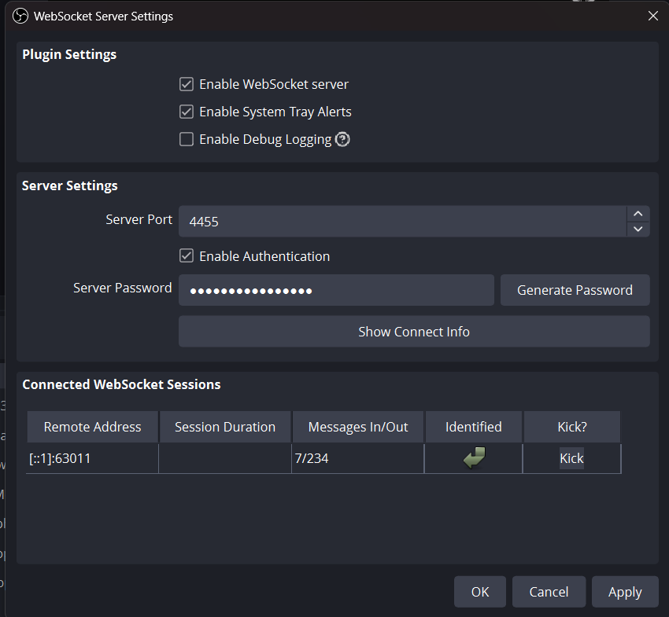
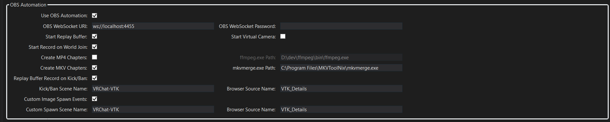
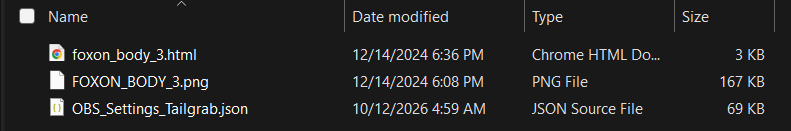
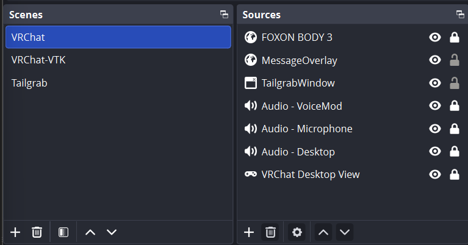

# Tailgrab OBS Integration

This guide explains how to install OBS, place the supplied Tailgrab asset pack in the correct Windows folder, import the Tailgrab scene configuration, and understand the main overlay sources used in the VRChat scene.

## Features of Tailgrab OBS Integration
- Auto Start of OBS Session Recording
- Auto Start of OBS Replay Buffer
- Auto Start of OBS Virtual Camera
- Auto Capture of Vote to Kick events, both moderated and un-moderated instance from the Replay Buffer settings
- Auto Capture of Warn, Kick, Ban events in a moderated instance from the Replay Buffer Settings
- Auto Rename of Replay Buffer file to match the {UserID}_{DisplayName}_{EventDateTime}.{ext} to make it easy to attach evidence to your logs.
- Automated Generation of Chapter markers for session events, embedding them into a mp4 or mkv file format.
- Automated Generation of 'Video Contact Sheets'; a 5x5 thumbnail rendering of the video file.
- Automated Generation of 'Animated Thumbnail' WebP file for use in Discord or other social media platforms.
- Video Embedding of VTK, Warn, Kick, Ban events into the video file for evidential purposes.
- Video Embedding of Print, Sticker and Emoji events into the video file for evidential purposes.


## 1. Install Open Broadcaster Studio (OBS)

1. Download OBS Studio from the official project site:
   - https://obsproject.com/download
2. Run the installer and follow the normal Windows setup process.
3. Accept the default install location unless you specifically want to change it.
4. Launch OBS Studio after installation.
5. If Windows prompts for permissions or firewall access, allow it so OBS can capture application windows and audio.

OBS is the software used to capture the game view, application window, and overlay content for Tailgrab recordings and streaming.

## 2. Configure OBS WebSocket Server

The Tailgrab application can communicate with OBS through the WebSocket Server to give you some special features:
 - Running Session Event logging to video
 - Auto Start Replay Buffer
 - Auto Start Virtual Camera (Can be used to stream your activity to Discord or other streaming platform)
 - Capture Vote to Kick events, both moderated and un-moderated instance from the Replay Buffer settings
 - Capture Warn, Kick, Ban events in a moderated instance from the Replay Buffer Settings
 - Auto Rename Replay Buffer file to match the {UserID}_{DisplayName}_{EventDateTime}.{ext} to make it easy to attach evidence to your logs.
 - Automated Session Recording using OBS
 - Create Chapter markers for session events, embedding them into a mp4 or mkv file format.
 - Near-Real-Time video recording of Print, Sticker and Emoji events, giving you the ability to do evidential recording of rule violations.

 For any of these features You must enable and configure this websocket server, then provide the connection details to Tailgrab.

### Enable the WebSocket Server in OBS

1. In OBS Studio, open the menu: **Tools** → **WebSocket Server Settings**.
2. A dialog box will appear (see reference image below).
3. Ensure the checkbox for **Enable WebSocket Server** is checked.
4. Note the following settings (or keep the defaults):
   - **Server Port**: Default is `4444` (or `4455` depending on OBS version)
   - **Server Password**: At the time of this documentation, this is auto generated, click on 'Show Connect Info' to display settings needed by Tailgrab.

Reference image:



### Obtain the connection details

Record the following information from the WebSocket Server Settings:

- **IP Address**: The machine's local IP address or `localhost` (or `127.0.0.1`) if Tailgrab is on the same machine.
- **Port**: The server port (default `4444` or `4455`).
- **Password**: The server password (leave blank if no password is set, or use the password you configured).

If you need to find your machine's IP address:

- Open Command Prompt and type: `ipconfig`
- Look for the IPv4 Address under your active network adapter (typically something like `192.168.x.x` or `10.x.x.x`).

### Enter the OBS settings into Tailgrab

1. Open the **Tailgrab application**.
2. Navigate to **Settings** or **Preferences**.
3. Find the **OBS Integration** or **OBS Settings** section.
4. Enter the following values:
   - **OBS WS IP Address**: Enter the IP address from step above (e.g., `ws://localhost` or `ws://192.168.1.100`).
   - **OBS Port**: Enter the port number (default `4444` or `4455`).
   - **OBS Password**: Enter the password generated by OBS from the 'Show Connect Info' dialog.
5. Click **Save** to confirm the settings.

Reference image:



### Verify the connection

- Once saved, Tailgrab should be restarted and once restarted, OBS will indicate that it has a WebSocket conneection.
- If connection fails, verify that:
  - OBS is running and the WebSocket Server is enabled.
  - The IP address and port are correct.
  - The password (if set) matches exactly.
  - No firewall is blocking the connection on the configured port.

## 3. Extract the Tailgrab OBS asset pack

Download and extract the zip file [`📦 OBSAssets.zip`](OBSAssets.zip) into the following directory:

`C:\Users\Public\Documents\OBSAssets\Tailgrab`

This ensures all browser sources and the example OBS scene settings are available in a standard settings area of your host.

Example reference image for the expected extracted layout:



The extracted folder should contain the Tailgrab overlay HTML, browser source files, and the imported scene configuration JSON.

## 4. Import the Tailgrab scene configuration into OBS

This gives a basic Scene Configuration in your OBS that has scenes & sources in those scenes that Tailgrab knows how to enable and manipuate while running.  You can hide them or delete them if you do not like their use, but some names like the Session EventLog are expected to be a browser source named 'MessageOverlay'.  Special events have configuration elements to enable the switching of scenes and updating the browser source of the content.

In OBS Studio:

1. Open the `Scene Collection` menu.
2. Choose `Import`.
3. Select the file:
   `C:\Users\Public\Documents\OBSAssets\Tailgrab\OBS_Settings_Tailgrab.json`
4. Confirm the import and allow the scene collection to load.

This imports the Tailgrab scene setup and restores the browser, capture, and audio sources used for the stream.

## 5. Overview of the overlay file `foxon_body_3.html`

The file:

`C:\Users\Public\Documents\OBSAssets\Tailgrab\foxon_body_3.html`

is used as an in-video overlay for captures. It acts as a browser source in OBS and is designed to sit over the capture area as a branded overlay for Tailgrab content.

This HTML file is ideal for a branded overlay, logo treatment, or stylized panel. It is easiest to edit by opening the file in a basic text editor such as Notepad++ or VS Code.

### How to edit the HTML for a custom logo

1. Open `foxon_body_3.html` in a text editor.
2. Locate the logo image or branding markup inside the HTML.
3. Replace the existing image path or source with your own logo file.
4. If the logo is embedded in CSS, update the relevant `background-image`, `src`, or class styling.
5. Save the file.
6. Refresh the browser source in OBS if the overlay is already active.

Typical changes include:

- Replacing the current logo image with a custom one
- Adjusting the overlay size or position
- Changing colors, transparency, or text styling
- Modifying border, glow, or panel effects

If you want the overlay to match a new brand identity, the HTML can be edited directly without changing the OBS scene structure.

## 6. Scene: VRChat

The main scene used for the capture is named `VRChat`.

Reference image:



This scene is designed to combine the VRChat gameplay, the Tailgrab application window, chat/activity messages, and the branded overlay into a single capture layout.

### Source: `FOXON BODY 3`

- Type: Browser source
- Source file: `C:\Users\Public\Documents\OBSAssets\Tailgrab\foxon_body_3.html`
- Purpose: Displays the branded Tailgrab/Foxon overlay visually over the captured content.
- Usage: This is the main in-video overlay layer that sits on top of the capture composition.

### Source: `MessageOverlay`

- Type: Browser source
- Purpose: Displays Tailgrab events, notifications, or status-driven text overlays.
- Usage: Used for messages, event announcements, or dynamic on-screen updates.
- IMPORTANT: If you wish to have the running event log in your instance recording, you need to have this Source named as 'MessageOverlay'

### Source: `TailgrabWindow`

- Type: Window capture / application capture
- Purpose: Captures the upper portion of the Tailgrab application window.
- Usage: This shows the Tailgrab UI or dashboard area while the main scene remains focused on the VRChat gameplay capture.
- IMPORTANT: As we have upgrades and the Version Number title changes for Tailgrab, OBS cannot find the new version, simply dobuble click on the source, and select the new Tailgrab Window name.  OBS will remember this from this point forward.

### Audio sources

The scene includes audio inputs for monitoring and visualizing mic/game/source levels.

- Purpose: Provide real-time visual feedback for active audio inputs.
- Usage: Helps confirm microphone, game audio, and other sources are clean and correctly balanced before recording or streaming.
- Typical role: Each audio source is displayed as a visualizer or incoming volume meter in the scene.

### Source: `VRChat Desktop View`

- Type: Application capture
- Purpose: Captures the desktop window for VRChat.
- Usage: This source provides the main game or desktop gameplay view used in the VRChat scene composition.
- NOTE: I have tried to use the VR Eye capture on OBS, but SteamLink tends to hate it and give my relatively high end machine hiccups when enabled.  The Desktop capture works well and gives you a wide-screen representation of the content you are moderating in.

## 7. Recommended workflow

1. Place the extracted Tailgrab asset folder in `C:\Users\Public\Documents\OBSAssets\Tailgrab`.
2. Enable OBS Websocket Server; set settings in Tailgrab.
2. Import the file `OBS_Settings_Tailgrab.json` into OBS.
3. Ensure the browser sources point to the extracted HTML files.
4. Confirm that the `VRChat` scene loads correctly.
5. Validate the `FOXON BODY 3`, `MessageOverlay`, and `TailgrabWindow` sources.
6. Check the audio meters and the `VRChat Desktop View` capture before recording or streaming.

Example PowerShell script to launch OBS, Tailgrab, and the overlay:

**StartVRChatWithTailgrab.ps1**

```powershell
Start-Process -FilePath "C:\Program Files\obs-studio\bin\64bit\obs64.exe" -WorkingDirectory "C:\Program Files\obs-studio\bin\64bit"
Start-Sleep -Seconds 5

Start-Process "D:\dev\TailGrab\bin\Release\net10.0-windows\win-x64\publish\tailGrab.exe"
Start-Sleep -Seconds 10

Get-Content -Path (Get-ChildItem -Path $HOME\AppData\Local\Tailgrab\logs\ -File | Sort-Object LastWriteTime -Descending | Select-Object -First 1).FullName -Wait -Tail 100
```

## 8. Notes

- If a browser source does not render correctly, refresh the source or reselect the file path in OBS.
- If the HTML overlay does not update after editing, reload the browser source in OBS.
- Keep the asset folder in the public documents location so all builds and scene imports remain stable across user sessions.
